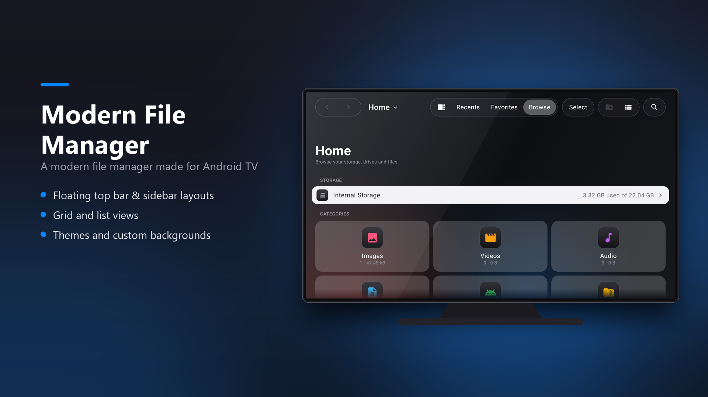
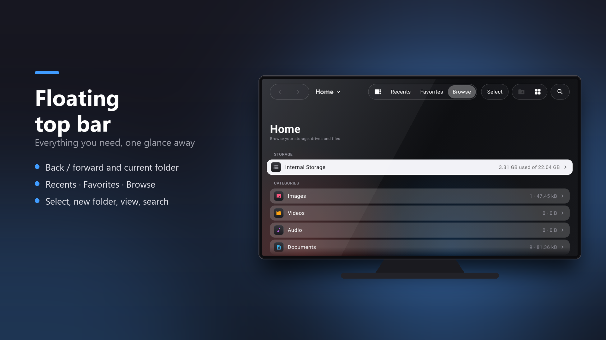
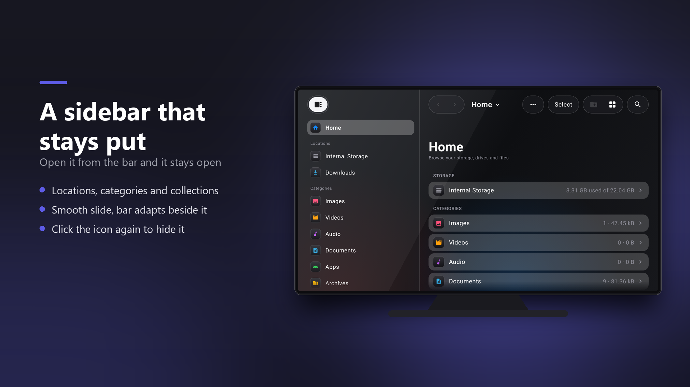
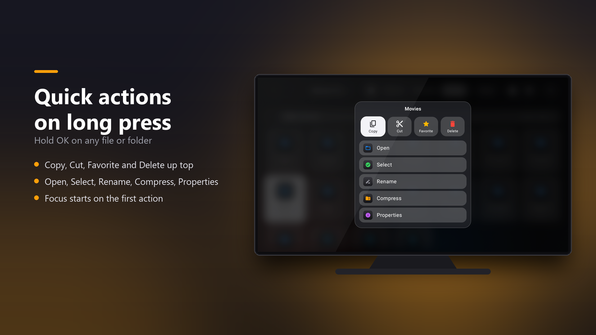
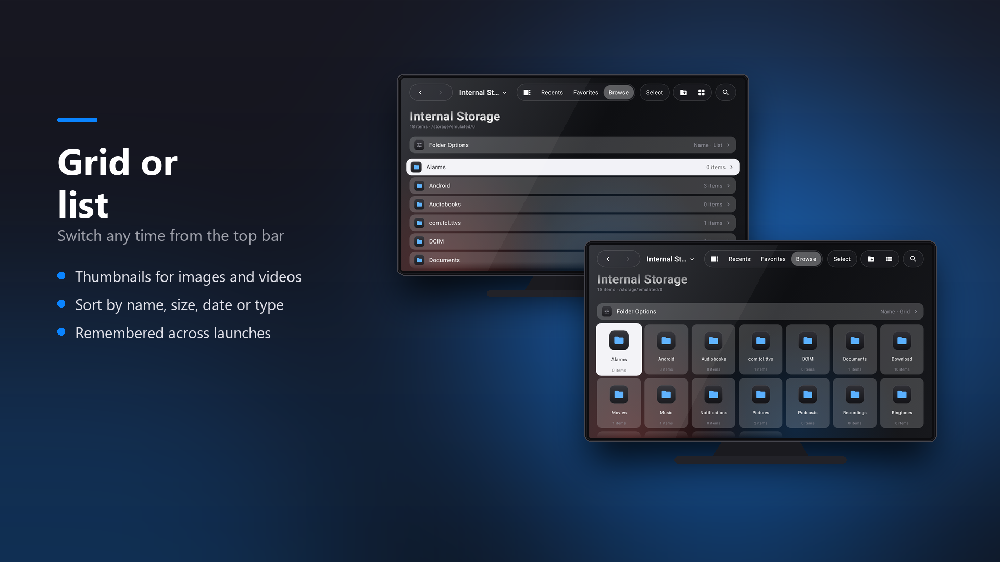
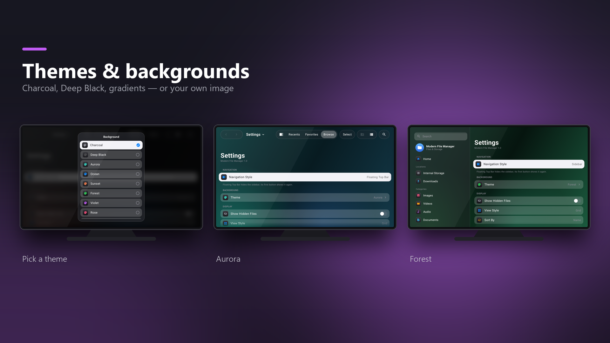

# Modern File Manager for Android TV

A clean, remote-friendly file manager built for the big screen. Browse storage, manage files and keep your TV tidy, all with a D-pad.



> This repository hosts the app's info page and release downloads only. The source code is not published.

## Features

- Home dashboard with storage overview and file categories (Images, Videos, Audio, Documents, APKs, Archives)
- Two navigation layouts: sidebar or floating top bar
- Grid and list views with sorting
- Favorites, recents and search
- Quick actions menu: copy, cut, rename, compress (zip), delete, properties
- Multi-select mode for bulk actions
- Built-in image viewer and text viewer
- Storage Cleaner with a donut chart and junk categories
- APK extractor
- 7 themes plus a custom image background
- Acts as a file picker for other apps
- Fully D-pad navigable

## Screenshots







## Install

Requires Android TV or Google TV running Android 8.0 (API 26) or newer.

1. Download `ModernFileManager_1.0-release.apk` from the [latest release](../../releases/latest).
2. Get it onto your TV: use a USB drive, or a sideloading app such as "Send Files to TV" or "Downloader", or `adb`:
   ```
   adb connect <tv-ip>:5555
   adb install ModernFileManager_1.0-release.apk
   ```
3. Allow installs from unknown sources for the app you used to open the APK, if prompted.
4. Open **Modern File Manager** from the TV launcher and grant "All files access" when asked.

## Permissions

- **All files access**: needed to browse and manage storage.
- **Install packages / query packages**: used by the APK extractor and the Storage Cleaner.

The app has no analytics and does not ask for network access.

## Credits

Made by [@gadgetcue](https://github.com/gadgetcue).
